# TutorLah User Guide

TutorLah is a **desktop application for freelance tutors in Singapore to keep track of their secondary and junior college (JC) students and the lessons they have taught them, optimized for use through a Command Line Interface (CLI)** while retaining the benefits of a Graphical User Interface (GUI). Store each student's contact details, level and subject, record what you covered after every lesson, and look back at a student's lesson history before the next one, without relying on scattered notes or memory. If you type quickly, TutorLah lets you do this faster than a typical mouse-driven application.

<page-nav-print />

--------------------------------------------------------------------------------------------------------------------

## Quick start

1. Ensure that Java `25` or later is installed on your computer.<br>
   **Mac users:** Ensure you have the precise JDK version prescribed [here](https://se-education.org/guides/tutorials/javaInstallationMac.html).

1. Download the latest `.jar` file from [here](https://github.com/AY2627S1-CS2103T-T11-1/tp/releases).

1. Copy the file to the folder you want to use as the _home folder_ for TutorLah. Your data will be saved in this folder.

1. Open a terminal, `cd` to the folder containing the JAR file, and run `java -jar TutorLah.jar`.<br>
   A GUI similar to the one below should appear in a few seconds. On first launch, the app contains sample students. The screenshot uses fictional student and lesson data after running `view 1`; your initial data may differ.<br>
   <a href="images/Ui.png">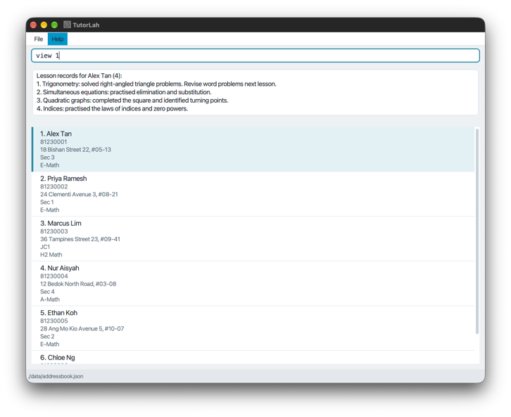</a>

   **Command used:** `view 1`. Alex Tan opens in the details panel on the right, with his three lessons newest date first.

   The window has four areas:

   * **Command box** (top): type commands here.
   * **Result box** (below the command box): shows the outcome of each command. A failed command turns the result box red and keeps your command in the command box, so you can correct it.
   * **Student list** (left): one compact card per displayed student, showing their number, initials, name, level, subject and lesson status. Flagged students have a red flag icon.
   * **Details panel** (right): the selected student's level, subject, phone, address, flag reason and numbered lesson records. See [the details panel](#the-details-panel) for when it changes.

1. Type a command in the command box and press Enter to execute it. For example, type **`help`** and press Enter to open the help window.<br>
   Some example commands you can try:

   * `list` : Lists all students.

   * `summary` : Shows a short paragraph summarising all students and lesson records.
   * `unlogged` : Shows students with no recorded lessons.

   * `find wei` : Shows students with `wei` anywhere in their name. Use `list` to show all students again.

   * `flag 2 r/Missed homework twice` : Marks the 2nd displayed student for follow-up and records why.

   * `flagged` : Shows all students currently marked for follow-up.

   * `add n/Tan Wei Ming p/87654321 addr/Blk 8 Bishan St 22, #05-13 l/JC1 sub/H2 Math` : Adds a JC1 student named `Tan Wei Ming` who is taking H2 Math.

   * `log 1 c/Quadratic inequalities` : Records a lesson on quadratic inequalities for the 1st student in the list.

   * `view 1` : Shows the lesson records of the 1st student in the list, most recent first.

   * `findlesson 1 algebra` : Searches the 1st student's lesson content for `algebra`.

   * `delete 3` : Deletes the 3rd student shown in the current list, together with their lesson records.

   * `exit` : Exits the app.

1. Refer to the [Features](#features) section below for details of each command.

--------------------------------------------------------------------------------------------------------------------

## Features

<box type="info" seamless>

**Notes about the command format:**<br>

* The command box clears after a successful command. Screenshot captions state which commands produced the displayed results. Main-window screenshots use the same window size and display width. Screenshots use fictional data; your student names and indexes may differ. Click a screenshot to open its full-size image.

* Words in `UPPER_CASE` are the parameters to be supplied by the user.<br>
  For example, in `add n/NAME`, replace `NAME` with a value such as `Tan Wei Ming`.

* Command words ignore uppercase/lowercase, so `list`, `LIST` and `LiSt` work the same way.
  Prefixes such as `n/`, `p/` and `c/` are lowercase and must be typed exactly as shown.

* Parameters with prefixes can be in any order.<br>
  For example, if the command specifies `n/NAME p/PHONE`, `p/PHONE n/NAME` is also acceptable.

* `INDEX` refers to the number shown beside a student in the currently displayed student list. It must be a positive integer without leading zeros, such as 1, 2, 3, ...

* Extraneous parameters for `help` and `exit` are ignored.<br>
  For example, `help 123` is interpreted as `help`.

* Non-breaking spaces copied from websites or documents work as separators
  between the command word, indexes and prefixed fields, just like ordinary spaces.
  Pasted tabs and line breaks become spaces rather than joining words. Paste one
  command at a time, check it in the command box, then press Enter to run it.

* A prefix used by the command you are typing starts a new field wherever it follows whitespace
  (an ordinary space, a non-breaking space or a tab). Other slashes are ordinary text, so `a/l` in a
  name or `d/dx` in lesson notes is kept. If your text contains one of that command's prefixes after a
  space, such as `c/o` in `log` notes, reword it, for example `care of`. When this causes an error,
  such as `Multiple values specified for the following single-valued field(s): c/`, the message adds
  `A recognised prefix after a space starts another field. If it was part of your text, please reword it.`
  A command that is still valid is not detected: `edit 1 addr/Unit l/2` changes the address to `Unit`
  and the level to `2`.
</box>

### Viewing help: `help`

Shows a message explaining how to access the help page.

Use the **Copy URL** button to copy the User Guide link and open it in your browser.


Format: `help`


### Adding a student: `add`

Adds a student to the end of the student list.

Format: `add n/NAME p/PHONE addr/ADDRESS l/LEVEL sub/SUBJECT`

* All five fields are required.
* `NAME` is 1 to 100 characters of letters, spaces, apostrophes, hyphens, periods and slashes, with at least one letter and no digits. Repeated spaces are reduced to one. Names such as `Ramesh s/o Kumar`, `Muthu a/l Raju` and `Siti a/p Ahmad` work.
* The address prefix is `addr/`, not `a/`, so `a/l` and `a/p` in a name are kept as part of the name. If you type `a/` and leave out `addr/`, the error message reminds you to use `addr/`.
* `PHONE` must be exactly 8 digits. Spaces between digits are removed, so `9123 4567` is saved as `91234567`. Do not add `+65` or another country code.
* `ADDRESS` is 1 to 200 characters. It cannot contain only whitespace or invisible formatting characters, such as non-breaking spaces and zero-width spaces.
* `LEVEL` is 1 to 40 characters of letters, digits and spaces, such as `Sec 3`, `JC1` or `Sec 4 Normal Academic`.
* `SUBJECT` is 1 to 50 characters of letters, digits, spaces and hyphens, such as `E-Math`, `Physics` or `H2 Chemistry`.
* If a phone, level or subject fails validation, a separate prefix-like token after an otherwise valid
  value, such as `sub/Math t/friend`, adds the hint
  `If t/ was intended as a field, add accepts only n/, p/, addr/, l/ and sub/.`
  `sub/Physics/Chemistry` and invalid names or addresses keep their normal errors. This hint does not
  introduce extra fields or change validation.
* A student with the same phone number and the same name as an existing student, ignoring case, is a duplicate and is rejected with `This student already exists in the list.`

Examples:
* `add n/Tan Wei Ming p/87654321 addr/Blk 8 Bishan St 22, #05-13 l/JC1 sub/H2 Math`
* `add n/Ramesh s/o Kumar p/9123 4567 addr/12 Clementi Rd l/Sec 3 sub/Physics`

**Screenshot example:** `add n/Jamie Lee p/81230007 addr/60 Example Street l/JC1 sub/Physics` adds a JC1 student taking Physics. The confirmation shows the saved details, and Jamie's new card at the bottom of the list shows the name, level and subject:

<a href="images/add-student.png">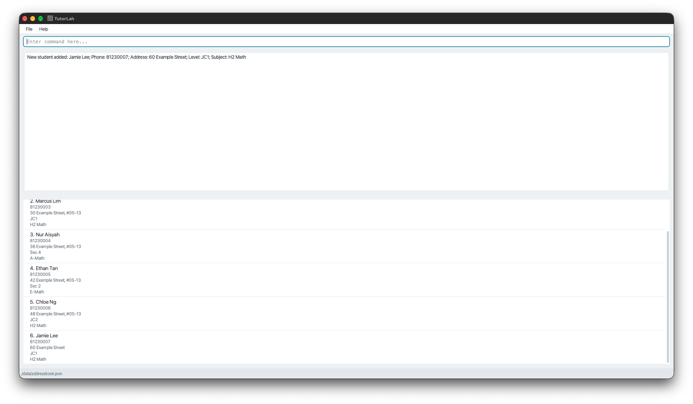</a>

### Listing all students: `list`

Shows all students and reports the number displayed.

Format: `list`

* Restores the full student list after a `find`, `flagged` or `unlogged` command.
* With students: `Listed {COUNT} students.`, for example `Listed 3 students.`
* With one student: `Listed 1 student.`
* Without students: `No students found. Use add to create a student.`
* Extra arguments, such as `list 3`, are rejected with
  `The list command does not accept parameters.`. No student data is changed.

**Screenshot example:** after `find TAN`, run `list`. The confirmation `Listed 6 students.` shows that the full list has been restored. Priya Ramesh is again student 2:

<a href="images/list-students.png">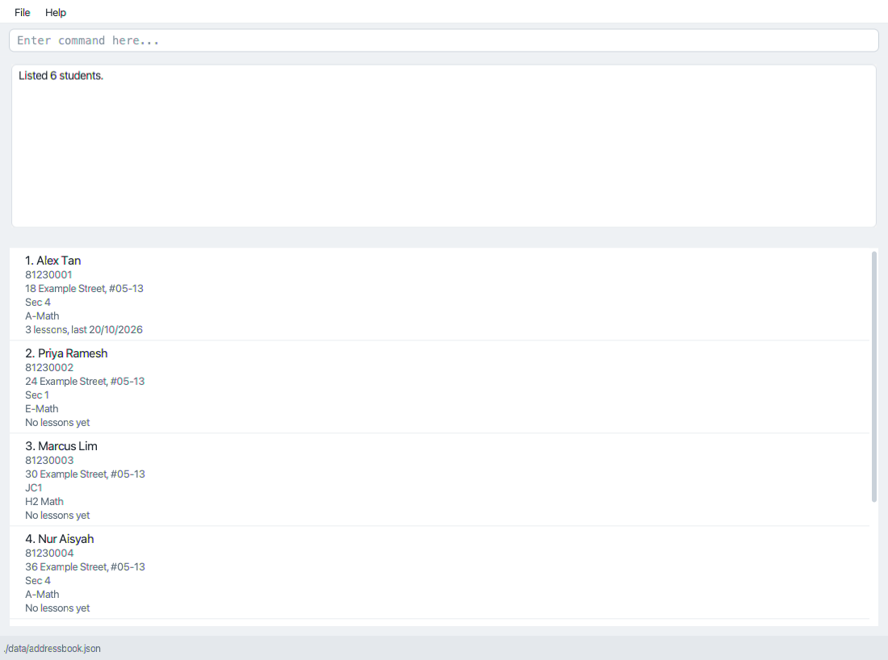</a>

### Viewing student and lesson totals: `summary`

Shows an overview of all students and their recorded lessons.

Format: `summary`

Example output for three students with three lesson records between them, one of whom has no records:

```text
Summary:
You have 3 students and 3 lesson records in total. 1 student has no lessons recorded.
```

* A short paragraph describes the collection and highlights students without recorded lessons. With no students, it suggests adding a student.
* Totals include **all saved students**, even after `find`, `flagged` or `unlogged` hides some cards. The current filter and displayed student numbers are kept. Use `list` to restore all cards.
* Every lesson record counts, including undated records saved before v1.4 and separate records with identical content. These totals describe recorded history, not scheduled lessons or teaching hours.
* `summary` accepts no parameters. For example, `summary 1` shows the summary usage and keeps the current list.
* The command introduces no new saved fields and does not change students or lessons. It does not attempt to save, so it also works while saving is unavailable.

**Screenshot example:** after `summary`, the complete collection contains six students and three lesson records. Alex Tan has three dated records, and the other five students have none:

<a href="images/summary.png">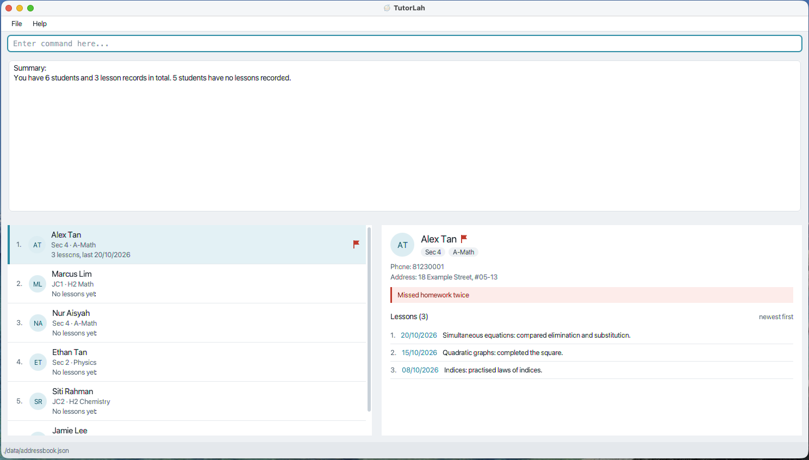</a>

Each student card also shows a lesson-status line below the subject:

| Recorded history | Card line |
|---|---|
| No lessons | `No lessons yet` |
| One dated lesson | `1 lesson, last 21/10/2026` |
| Multiple dated lessons | `5 lessons, last 21/10/2026` |
| Only undated lessons | `5 lessons (undated)` |

`last` means the most recent **recorded lesson date**, rather than when a command was typed. When dated and undated lessons coexist, all records count and the most recent dated lesson supplies the date. The line refreshes after `log`, `editlesson` and `deletelesson`, and a flagged student's flag icon remains visible.

### Listing students without lesson records: `unlogged`

Shows students who have no lesson records, so you can follow up on the summary's count of students without recorded lessons.

Format: `unlogged`

* Checks **all students**, replacing any previous `find`, `flagged` or `unlogged` filter. Matches keep their original order and are numbered from 1. Other commands use these displayed student numbers.
* A student with even one undated lesson has recorded history and is not included. This identifies missing records, not whether teaching has taken place.
* Feedback is `Listed 1 student with no recorded lessons.` or `Listed N students with no recorded lessons.`. With no matches, including when no students are saved, it says `No students without lesson records found. Use list to show all students.`
* Logging a first lesson removes that student from the results automatically. The remaining students are renumbered, so check the displayed list before the next command. The details panel still shows the student whose lesson you just logged.
* `list` restores all students; `find` and `flagged` replace this filter. `summary` still counts all students and keeps the filter. Filters are not saved across restarts.
* `unlogged` changes no student or lesson data and does not attempt to save, including while saving is disabled. Extra arguments such as `unlogged 1` are rejected with `The unlogged command does not accept parameters.` and keep the current filter.

**Screenshot example:** Amy Tan has a recorded lesson and Ben Lim has none. After `unlogged`, only Ben is displayed, renumbered to student 1:

<a href="images/unlogged.png">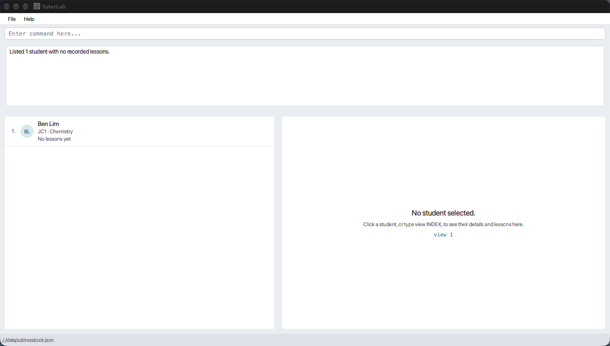</a>

### Finding students: `find`

Shows students whose name, subject or level contain the search keywords, for example to bring up every Sec 3 Physics student before preparing material for them. You can use part of a word instead of typing it in full.

Format: `find [KEYWORD]... [n/NAME] [sub/SUBJECT] [l/LEVEL]`

* At least one keyword or field is required. `find` on its own shows the invalid command format message and usage; the displayed list is unchanged.
* Keywords typed before any prefix search names, as do the keywords after `n/`. `sub/` searches subjects and `l/` searches levels. `find tan`, `find n/tan` and `find tan n/wei` all search names.
* Every word after `sub/` or `l/`, up to the next prefix, searches that field, so put name keywords first. `find ng sub/Physics` finds Chloe Ng taking Physics, while `find sub/Physics ng` looks for a subject containing both `Physics` and `ng`.
* Matching ignores uppercase/lowercase. `find TAN` and `find sub/physics` match `Tan` and `Physics`.
* Every keyword must occur somewhere in its field, in any order. With `Alex Tan` and `Ethan Tan` saved, `find tan` shows both students, while `find alex tan` shows only `Alex Tan`. `l/Sec 3` needs both `Sec` and `3` in the level.
* When several fields are given, a student must match all of them. `find sub/Physics l/Sec 3` shows only Sec 3 students taking Physics.
* Each field can be given at most once. `find sub/Math sub/Physics` is rejected with `Multiple values specified for the following single-valued field(s): sub/`, followed by the hint to reword prefix text.
* A field cannot be blank. `find sub/` is rejected with the same message as an invalid subject in `add`, and likewise for `n/` and `l/`.
* Leading, trailing and repeated whitespace is ignored. Keywords are literal text, with no wildcard matching or spelling correction. Punctuation and accented characters must match as entered, ignoring case.
* Only lowercase `n/`, `sub/` and `l/` are fields. Other text that looks like a prefix, such as `a/l`, is searched as part of the name.
* Each search checks all saved students, replacing the previous `find`, `flagged` or `unlogged` filter. The matches keep their original list order.
* With one match: `Found 1 student.` With multiple matches: `Found {COUNT} students.` With no matches: `No matching students found. Use list to show all students.` If the search used names only, such as `find physics`, the message adds `To search by subject or level, use sub/ or l/, e.g. find sub/Physics.`, because keywords without a prefix search names, not subjects or levels. If moving the last words after `sub/` or `l/` to the names would find someone, the message adds `Words after sub/ or l/ search only that field. Did you mean: find ng sub/Physics?` with the suggested search.
* Matches are numbered from 1. Use these displayed numbers for `view`, `log`, `edit` and `delete`, or click a matching card to view its history.
* `find` does not change or delete student details or lesson records. Type `list` to restore all students. Search filters are not saved across restarts.
* Adding or editing a student also restores the full list. Viewing, logging and deleting use the current filter.

Examples:
* `find ali` matches `Alice Tan` and `Alicia Lim`.
* `find tan ming` matches `Tan Wei Ming` and `Ming Tan`.
* `find sub/Physics l/Sec 3` matches Sec 3 students taking Physics.
* `find tan sub/math` matches students named Tan whose subject contains `math`, such as `E-Math` or `H2 Math`.
* `find Muthu a/l Raju` matches a saved name of `Muthu A/L Raju`.

**Screenshot example:** after `find TAN`, only Alex Tan and Ethan Tan are displayed, numbered 1 and 2:

<a href="images/find-students.png">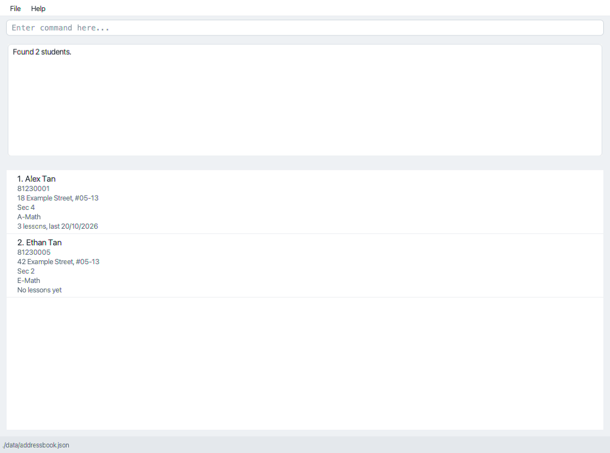</a>

### Flagging students for follow-up: `flag`, `unflag`, `flagged`

Use a flag to mark a student who needs follow-up. A reason is optional. Flagged students show a red flag icon on their card and beside their name in the details panel. The details panel also shows the reason in a red banner, or `Flagged (no reason given)` if there is none. `flag` and `unflag` open the student in the details panel.

Formats:

* `flag INDEX [r/REASON]`
* `unflag INDEX`
* `flagged`

`flag` and `unflag` use the student's number in the currently displayed list. `flagged` searches the complete saved student collection, displays all flagged students in their original order, and numbers the results from 1. The displayed numbers can be used directly with other index-based commands. Type `list` to restore all students.

The optional `REASON`:

* is 1 to 100 characters after surrounding whitespace is removed;
* cannot be blank or contain control characters; and
* may contain punctuation and text that resembles another prefix, such as `a/level`, `date/` or `c/homework`, because only lowercase `r/` is parsed by `flag`.

Flagging an unflagged student adds the flag. Flagging an already flagged student with a different reason replaces the old reason. Repeating the same reason is rejected with `NAME is already flagged with that reason.` Omitting `r/` for an already flagged student keeps any existing reason and reports `NAME is already flagged.`

`unflag` removes both the flag and its reason. Trying to unflag an unflagged student reports `NAME is not flagged.` When `unflag` is run from the `flagged` results, that student disappears from the displayed list because they no longer match the filter.

Examples:

* `flag 2`
* `flag 2 r/Missed homework twice`
* `unflag 2`
* `flagged`

Flags are saved automatically. Editing a student's details, logging a lesson or deleting one lesson does not change their flag. The active `find` or `flagged` filter itself is not saved across restarts.

**Screenshot example:** `flag 1 r/Missed homework twice` marks Alex Tan. His card shows a red flag icon, and the details panel shows the reason in a red banner:

<a href="images/flag-student.png">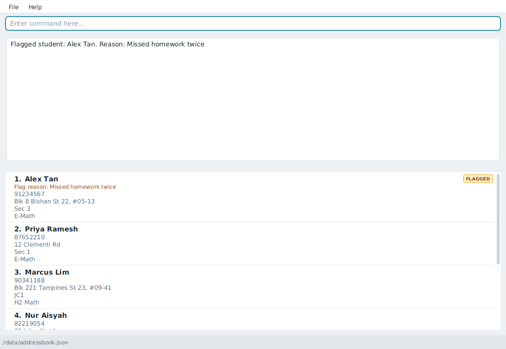</a>

### Editing a student: `edit`

Changes the details of an existing student. The student's lesson records and follow-up flag are kept.

Format: `edit INDEX [n/NAME] [p/PHONE] [addr/ADDRESS] [l/LEVEL] [sub/SUBJECT]`

* Edits the student at the specified `INDEX`. The index refers to the index number shown in the displayed student list, and **must be a positive integer** 1, 2, 3, ...
* At least one field must be given. Fields can be given in any order, and each field can be given at most once.
* Only the fields given are changed. Each field follows the same rules as in [`add`](#adding-a-student-add).
* Lesson records and the follow-up flag are not changed, and `view` shows the lessons as before.
* After an edit, all students are listed again and the edited student opens in the details panel.
* Editing a student so that they have the same phone number and the same name as another student, ignoring case, is rejected with `This student already exists in the list.`
* If no field is given, for example `edit 1`, the edit is rejected with `At least one field to edit must be provided.`
* A new name containing `a/l` or `a/p`, such as `edit 1 n/Muthu a/l Raju`, changes only the name; the address stays the same.

Examples:
* `edit 1 p/91234567` changes the phone number of the 1st student.
* `edit 2 l/Sec 4 sub/A-Math` changes the level and subject of the 2nd student.

**Screenshot example:** `edit 1 l/Sec 4 sub/A-Math` updates Alex Tan's level and subject. The confirmation, his student card and the details panel show the new values:

<a href="images/edit-student.png">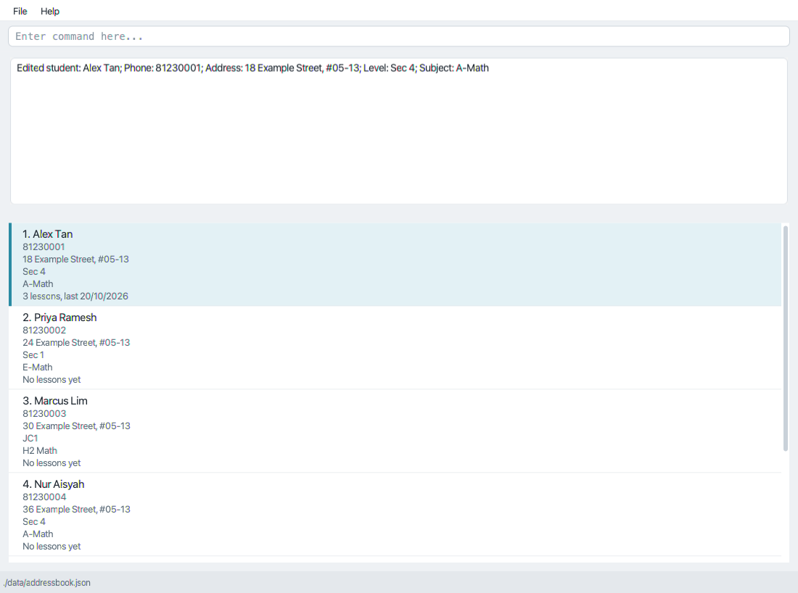</a>

### Deleting a student: `delete`

Deletes the specified student, together with their lesson records.

Format: `delete INDEX`

* Deletes the student at the specified `INDEX`.
* The index refers to the index number shown in the displayed student list.
* The index **must be a positive integer** 1, 2, 3, ...

Examples:
* `list` followed by `delete 2` deletes the 2nd student in the list.

**Screenshot example:** starting from the six-student list shown in the `list` example, `delete 2` removes Priya Ramesh. The confirmation identifies the deleted student, and Marcus Lim becomes student 2:

<a href="images/delete-student.png">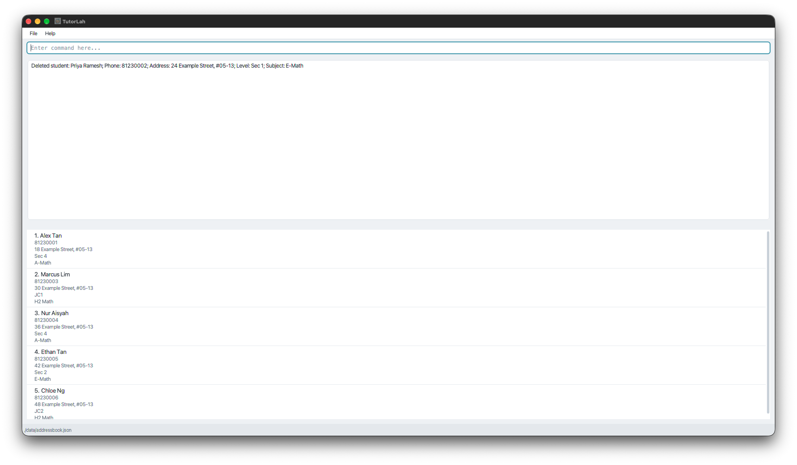</a>

### Viewing a student's lesson records: `view`

Opens one student in the details panel on the right, showing their details and all their lesson records. The same records are also listed in the result box.

Format: `view INDEX`

You can also left-click a student's card to view the same student. After clicking
the student list, the Up and Down arrow keys, Page Up, Page Down, Home and End move
to another student and view them. Viewing by any of these methods highlights the
student's card and scrolls it into view. A single left-click switches students
directly from the command box. Any text you are typing in the command box is preserved.

* `INDEX` is a positive integer from the currently displayed student list.
* Records appear with the most recent date first, numbered from 1. Records on the same date appear with the most recently logged first. These numbers identify rows in the output, not student indexes.
* Each record shows the lesson date, as `DD/MM/YYYY`, then what was covered, for example `1. 18/10/2026: Quadratic inequalities`.
* Lessons logged before v1.4 have no date and show `(undated)` in place of the date, for example `2. (undated): Binomial theorem`.
* Repeated lesson content is displayed as separate records. Viewing does not change records or the current student filter.
* A student with no records produces `No lessons logged yet for NAME.`
* The header is `Lesson records for NAME (COUNT):`, followed by one line per record in the form `NUMBER. DATE: CONTENT`.
* Missing indexes, non-integers, and extra arguments produce an invalid-command-format message with usage. Zero, negative integers, leading-zero integers, integers too large to parse, and indexes outside the displayed list produce `The student index provided is invalid.`

Example: `log 1 c/Algebra` followed by `log 1 c/Geometry` and `view 1` displays Geometry before Algebra, each with today's date.

**Screenshot example:** `view 1` opens Alex Tan in the details panel with his three dated lessons, newest date first, and highlights his student card:

<a href="images/Ui.png"></a>

#### The details panel

The details panel always shows one student, or a hint when no student is selected.

* **Opening a student:** `view`, clicking a card, moving through the list with the arrow keys, `findlesson`, and any command that changes one student (`log`, `edit`, `editlesson`, `deletelesson`, `flag` and `unflag`) open that student in the panel. Changes appear immediately, so you do not need to run `view` again.
* **Lesson numbers** in the panel are the same numbers that `view`, `editlesson` and `deletelesson` use. Lesson 1 is the most recent.
* **No lessons yet:** the panel shows an example `log` command for that student.
* **Other commands** such as `list`, `find`, `flagged`, `summary` and `add` keep the same student in the panel while they are still in the displayed list. If `find` or `flagged` hides them, or `delete` removes them, the panel returns to the hint.
* **Failed commands** never change the panel or the highlighted card, including when TutorLah cannot save your data.
* After `unflag` in the `flagged` results, the student leaves the list but stays in the panel, so you can see what changed.
* When TutorLah starts, no student is selected.

### Searching a student's lessons: `findlesson`

Finds when a topic was covered or what was recorded over a period for one student.

Format: `findlesson INDEX [KEYWORDS] [from/DATE] [to/DATE]`

* `INDEX` is the student's number in the currently displayed list, including after
  `find` or `flagged`.
* Supply at least one keyword, `from/`, or `to/`. Put all keywords before the first
  date prefix. The two date prefixes may appear in either order, once each.
  Keywords after a valid date give a message explaining the order, with a corrected
  example. Invalid dates still give the date-constraint message.
* Every keyword must occur somewhere in the lesson content, ignoring case and
  keyword order. Partial words match; punctuation is literal, not a wildcard or
  regular expression.
* Dates use the same `DD/MM/YYYY` rules as `log`, including single-digit days/months
  and the earliest date 01/01/2000. Unlike logging, future search boundaries are allowed.
* Both boundaries are inclusive. One boundary leaves the other end open. Equal
  boundaries search one day; a `from/` date after `to/` gives
  `The from date must be on or before the to date.`.
* Content and date criteria must all match. With no dates, undated legacy lessons
  can match by content. Supplying either date boundary excludes undated lessons.
* Results are newest-first and keep the lesson numbers from the complete
  `view INDEX` history. Gaps are intentional: matching lessons 2 and 4 stay numbered
  2 and 4, so you can use those numbers directly with `editlesson` or `deletelesson`.
* Numbers are positions, not permanent IDs. Logging, deleting or changing a lesson's
  date can change them; run the search or `view` again before acting on an older result.
* An empty history gives `No lessons logged yet for NAME.`. If records exist but
  none match, the message is `No matching lesson records found for NAME.`.
  If a keyword starts with lowercase `c/` or `date/`, a no-match result adds
  `To search by date, use from/ and to/. Content keywords need no prefix.`
  For example, use `findlesson 1 algebra`, not `findlesson 1 c/algebra`.
  These keywords remain literal text: successful matches do not show the hint.
* This is a one-off result, not a saved lesson filter. The matches appear in the
  result box, and the student opens in the details panel with their complete
  history. The student list and stored data do not change.

Examples:

* `findlesson 2 algebra` searches the 2nd displayed student's lesson content.
* `findlesson 2 from/01/10/2026 to/31/10/2026` searches their dated October records.
* `findlesson 2 revision from/01/10/2026` requires both the topic and the lower date
  boundary to match.

**Screenshot example:** `findlesson 1 algebra from/01/10/2026 to/31/10/2026` finds two
records for Amy Tan. The original lesson numbers 2 and 4 are kept in the result box,
Amy opens in the details panel with her complete history, and all three student
cards remain visible:

<a href="images/find-lessons.png">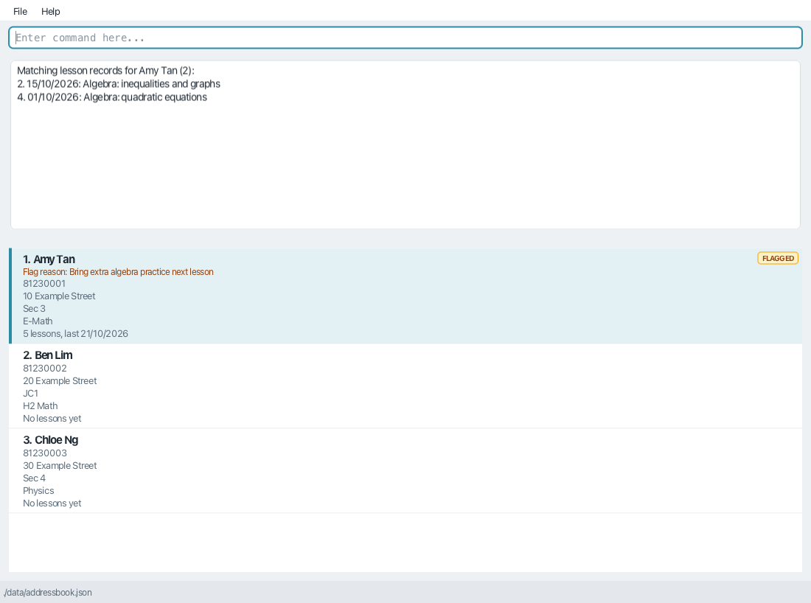</a>

### Reading long command results

Drag the horizontal divider below the result box to give command results more
space. Long text wraps automatically; scroll inside the result box to read older
records. Each command displays its feedback from the beginning. The command box
remains above the result box, and the student list and details panel remain below it.
Drag the vertical divider between the student list and the details panel to resize
them, and scroll inside the details panel to read a long lesson history.

### Logging a lesson: `log`

Records what you covered in a lesson for the specified student.

Format: `log INDEX c/CONTENT [date/DATE]`

* Logs a lesson for the student at the specified `INDEX`.
* The index refers to the index number shown in the displayed student list.
* The index **must be a positive integer** 1, 2, 3, ...
* `CONTENT` can be any text from 1 to 300 characters, e.g. the topics covered or homework set. It cannot contain only whitespace or invisible formatting characters, such as non-breaking spaces and zero-width spaces. Internal spaces and formatting characters used in real text are kept.
* `c/` and `date/` after a space always start a field, even inside your notes. Write `care of` instead of `c/o` and `date and time` instead of `date/time`. For example, `log 1 c/Worksheet collected care of Mum` works, while `log 1 c/Worksheet collected c/o Mum` is rejected as a repeated `c/`. An invalid date in `log` or `editlesson` also says `If "date/" was part of your lesson notes, please reword it, for example "date and time".`
* `DATE` is the day the lesson was taught, as `DD/MM/YYYY`, for example `21/10/2026`. Single-digit days and months such as `1/2/2026` are also accepted. Without `date/`, the lesson is dated with today's date on your computer.
* `DATE` must be a real date from 01/01/2000 up to today: future dates and dates such as `31/02/2026` are rejected. The day and month have one or two digits, and the year has exactly four.
* Confirmation: `Logged lesson for NAME on DD/MM/YYYY: CONTENT`, for example `Logged lesson for Tan Wei Ming on 18/10/2026: Quadratic inequalities`.
* Lessons are kept in date order, so a lesson logged later for an earlier date takes its place by date. Lessons on the same date keep the order they were logged in. Logging the same content twice records two lessons.
* To correct a logged lesson's content or date, use `editlesson`. To remove an incorrect record, use `deletelesson`. Both are described below.

Examples:
* `list` followed by `log 3 c/Quadratic inequalities` logs a lesson on quadratic inequalities for the 3rd student in the list.
* `log 1 c/Electric circuits: series and parallel, Q1-5 for homework` logs a lesson for the 1st student in the list.
* `log 2 c/Surds and indices date/20/10/2026` logs a lesson taught on 20 October 2026 for the 2nd student, placed among their records by that date.

**Screenshot example:** after `list`, the command `log 1 c/Trigonometry: solved right-angled triangle problems. date/18/10/2026` records an earlier lesson for Alex Tan. The confirmation includes the lesson date and content:

<a href="images/log-lesson-past-date.png">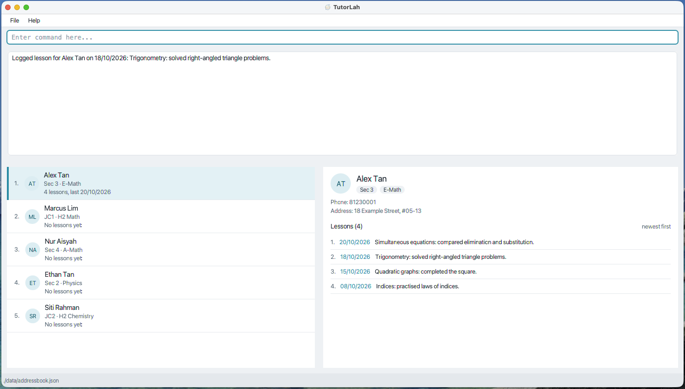</a>

### Deleting a lesson record: `deletelesson`

Deletes one lesson without deleting the student or their other lesson records.

Format: `deletelesson STUDENT_INDEX LESSON_INDEX`

* `STUDENT_INDEX` is the student's number in the currently displayed student list.
* `LESSON_INDEX` is the lesson's current number shown by `view STUDENT_INDEX`. Lesson 1 is the most recent lesson, not the oldest.
* Both indexes must be positive whole numbers without leading zeros. Exactly two arguments are required, in the order shown.
* Use `view STUDENT_INDEX` before deleting to check the lesson number. Numbers are positions, not permanent IDs: logging or deleting a lesson, or changing a lesson's date with `editlesson`, can change them. Running `view` first is recommended, not required.
* Only the selected occurrence is deleted, even if several lessons have identical content. Remaining lessons keep their order and are renumbered from 1 on the next view.
* Confirmation: `Deleted lesson LESSON_INDEX for NAME: CONTENT`. The details panel shows the remaining records, renumbered from 1.
* Student details, other students' records and the current student filter are unchanged. Deleting the final lesson keeps the student with an empty history.
* Missing arguments, non-integers such as `abc`, `+1` or `1.5`, and extra
  arguments produce an invalid-command-format message with usage. Zero,
  negative integers, leading-zero integers, overflowing integers and
  out-of-range indexes produce `The student index provided is invalid.` or
  `The lesson index provided is invalid.`, depending on the index.
* If the student's history is empty, a valid positive lesson number produces
  `No lessons logged yet for NAME.`. Nothing is deleted.
* Deletion is saved automatically and cannot be undone in the app. `delete INDEX` still deletes the entire student and all their lessons; it is a different command.

Example: after logging `Algebra`, then `Geometry` for student 2 on 18/10/2026, `view 2` shows `1. 18/10/2026: Geometry` and `2. 18/10/2026: Algebra`. `deletelesson 2 1` deletes Geometry and confirms `Deleted lesson 1 for NAME: Geometry`. A subsequent `view 2` shows only `1. 18/10/2026: Algebra`.

**Screenshot example:** after the past-date logging example above, `view 1` shows Alex Tan's four lessons in date order. The Trigonometry lesson dated 18/10/2026 is lesson 2:

<a href="images/lesson-history-before-delete.png">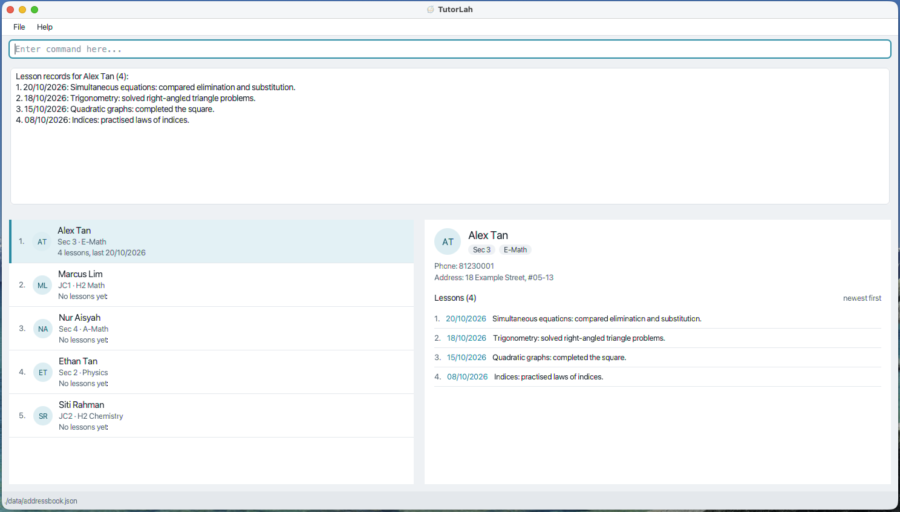</a>

Run `deletelesson 1 2`. The details panel immediately shows the three remaining lessons, numbered 1 to 3. Alex's student details are kept:

<a href="images/lesson-history-after-delete.png">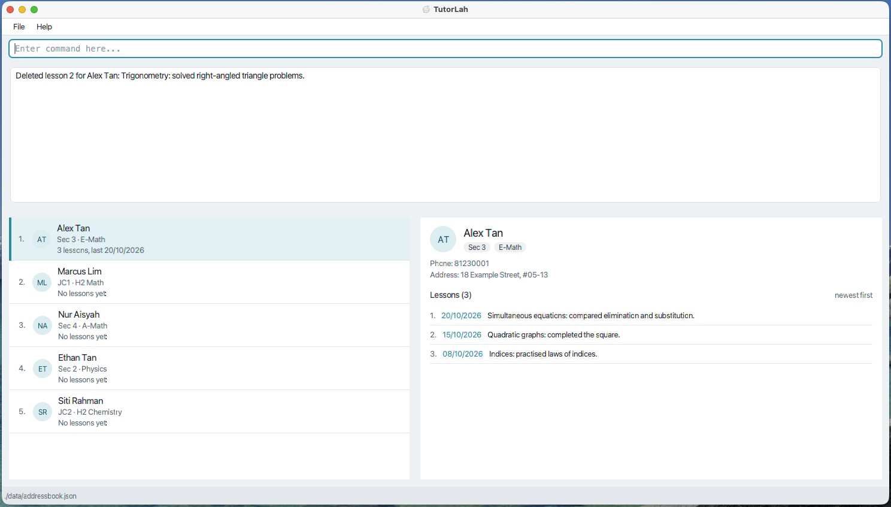</a>

### Editing a lesson record: `editlesson`

Corrects the content or date of one lesson record, without deleting it and logging it again.

Format: `editlesson STUDENT_INDEX LESSON_INDEX [c/CONTENT] [date/DATE]`

* `STUDENT_INDEX` and `LESSON_INDEX` work as in `deletelesson`: the student's number in the displayed student list, and the lesson's current number shown by `view STUDENT_INDEX`, where lesson 1 is the most recent.
* Give at least one of `c/` and `date/`. Without either, the command reports `At least one field to edit must be provided.`
* `c/CONTENT` replaces the lesson's content and `date/DATE` replaces its date. A field you leave out keeps its current value. Both follow the same rules as in `log`: content of 1 to 300 characters, and a real date from 01/01/2000 up to today. As in `log`, reword `c/` or `date/` inside the content, for example `care of` and `date and time`.
* Changing only the content keeps the lesson's number.
* Changing the date moves the lesson to its place in date order, so its number can change. On a date that already has lessons, the edited lesson goes after them, so `view` shows it first among that date's lessons. The confirmation gives the new number to use in later `editlesson` and `deletelesson` commands.
* Lessons saved before v1.4 have no date and show `(undated)`. Editing only their content keeps them undated, and giving `date/` dates them. A date cannot be removed from a dated lesson.
* If the new content and date are the same as the lesson's current ones, the command reports `The lesson already has those details.` and nothing changes.
* Confirmation: `Edited lesson LESSON_INDEX for NAME (now lesson NEW_INDEX). DATE: CONTENT`.
* Student details, other lessons, other students and the current student filter are unchanged. Index errors and an empty history give the same messages as `deletelesson`, and a future date gives the same message as `log`.

Examples:
* `editlesson 2 1 c/Quadratic inequalities and homework review` corrects the content of student 2's most recent lesson. It stays lesson 1.
* Suppose `view 1` shows `1. 23/10/2026: Trigonometry`, `2. 21/10/2026: Vectors` and `3. 19/10/2026: Algebra`. `editlesson 1 3 date/22/10/2026` moves Algebra to 22/10/2026 and confirms `Edited lesson 3 for NAME (now lesson 2). 22/10/2026: Algebra`. The details panel then lists Trigonometry, Algebra and Vectors, in that order.

### Exiting the program: `exit`

Exits the program.

Format: `exit`

### Saving the data

TutorLah automatically saves after a successful command changes student or lesson data. Commands that only display or filter data, open help or exit do not rewrite the student data file. You do not need to save manually.

Only one copy of TutorLah can use a data folder at a time. If another copy is already open from the same folder, the second copy explains the conflict and exits without loading or changing student data. Close the first copy before reopening TutorLah. The hidden `data/.tutorlah.lock` file may remain after TutorLah closes; it is harmless and does not mean the app is still running.

If saving fails, TutorLah reports the problem and restores the student data and list filter from before that command. Fix the reported file or permission problem before retrying. A failed deletion does not remove a student from memory or shift the indexes used by a retry. Student data and preferences are written to a temporary file before replacing the previous file. If the write or replacement fails, the previous saved file is kept; a failed first save leaves no empty data file. Saving requires a folder that supports atomic replacement of an existing file; otherwise, saving reports an error.

An abrupt shutdown, such as force-quitting TutorLah before the replacement finishes, may leave a hidden `.tutorlah-*.tmp` file beside the data or preferences file. These temporary files are not loaded as student data and are not automatically removed on restart. After closing all copies of TutorLah, you may delete these temporary files; keep `addressbook.json` and `preferences.json`.

### Editing the data file

TutorLah data is saved automatically as a JSON file `data/addressbook.json`, relative to the folder from which you launch the app. If you follow the Quick start steps, this is the folder containing the JAR. Advanced users are welcome to update data directly by editing that data file.

In the data file, a lesson's date is stored as `"date" : "YYYY-MM-DD"`, for example `"date" : "2026-10-18"`. A lesson without a `date` field is shown as `(undated)`. A date in any other format makes the data file invalid.

A flagged student with a reason stores `"flag" : { "reason" : "REASON" }`; a flag without a reason stores `"flag" : { }`. An unflagged student has no `flag` property. Data files created before flags were introduced therefore continue to load every student as unflagged.

Addresses and lesson content containing only whitespace or invisible formatting characters are invalid in data files too. If an older file contains these values, back up the file and correct them before opening it.

<box type="warning" seamless>

**Caution:**
If the data file cannot be loaded, TutorLah shows a startup warning with its location and starts with an empty student list. Saving is disabled for that session, so commands cannot overwrite the original file. Read-only commands such as `list`, `find`, `flagged`, `unlogged`, `help` and `exit` still work normally. A command that changes student or lesson data reports the saving-disabled error and restores the preceding data and filter. Close TutorLah using `exit` or the window's close button, make a backup of the file, then repair it or restore a valid copy at the same location. Restart TutorLah to load the recovered students and enable saving again. Repairing the file while the app remains open does not enable saving; a restart is required. Back up the file before editing it.<br>
Furthermore, certain edits can cause TutorLah to behave in unexpected ways (e.g., if a value entered is outside of the acceptable range). Therefore, edit the data file only if you are confident that you can update it correctly.
</box>

### Archiving data files `[coming in v2.0]`

_Details coming soon ..._

--------------------------------------------------------------------------------------------------------------------

## FAQ

**Q**: How do I transfer my data to another computer?<br>
**A**: Install the app on the other computer and overwrite the data file it creates with the data file from your previous TutorLah home folder.

--------------------------------------------------------------------------------------------------------------------

## Known issues

1. **When using multiple screens**, if you move the application to a secondary screen, and later switch to using only the primary screen, the GUI will open off-screen. The remedy is to delete the `preferences.json` file created by the application before running the application again.
2. **If you minimize the Help Window** and then run the `help` command (or use the `Help` menu, or the keyboard shortcut `F1`) again, the original Help Window will remain minimized, and no new Help Window will appear. The remedy is to manually restore the minimized Help Window.

--------------------------------------------------------------------------------------------------------------------

## Command summary

Action     | Format, Examples
-----------|----------------------------------------------------------------------------------------------------------------------------------------------------------------------
**Add**    | `add n/NAME p/PHONE addr/ADDRESS l/LEVEL sub/SUBJECT` <br> e.g., `add n/Tan Wei Ming p/87654321 addr/Blk 8 Bishan St 22, #05-13 l/JC1 sub/H2 Math`
**Delete** | `delete INDEX`<br> e.g., `delete 3`
**Delete lesson** | `deletelesson STUDENT_INDEX LESSON_INDEX`<br> e.g., `view 2`, then `deletelesson 2 1`
**Edit**   | `edit INDEX [n/NAME] [p/PHONE] [addr/ADDRESS] [l/LEVEL] [sub/SUBJECT]`<br> e.g., `edit 2 l/Sec 4 sub/A-Math`
**Edit lesson** | `editlesson STUDENT_INDEX LESSON_INDEX [c/CONTENT] [date/DATE]`<br> e.g., `editlesson 2 1 c/Vectors date/21/10/2026`
**Find**   | `find [KEYWORD]... [n/NAME] [sub/SUBJECT] [l/LEVEL]`<br> e.g., `find tan wei`, `find sub/Physics l/Sec 3` (use `list` to show all students again)
**Find lesson** | `findlesson INDEX [KEYWORDS] [from/DATE] [to/DATE]`<br> e.g., `findlesson 2 algebra from/01/10/2026`
**Flag**   | `flag INDEX [r/REASON]`<br> e.g., `flag 2 r/Missed homework twice`
**Flagged** | `flagged` (use `list` to show all students again)
**List**   | `list`
**Summary** | `summary` (totals cover all students and keep the current filter)
**View**   | `view INDEX`<br> e.g., `view 1`
**Log**    | `log INDEX c/CONTENT [date/DATE]`<br> e.g., `log 3 c/Quadratic inequalities date/21/10/2026`
**Unflag** | `unflag INDEX`<br> e.g., `unflag 2`
**Unlogged** | `unlogged` (use `list` to show all students again)
**Help**   | `help`
**Exit**   | `exit`
